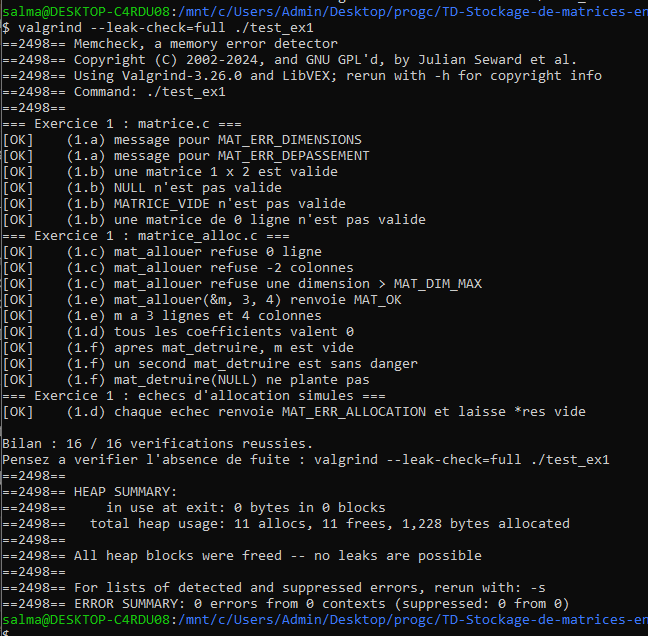
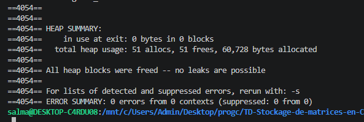

# TD — Stockage de matrices en C

**Établissement :** INSA Centre-Val de Loire  
**Formation :** 3A Sciences et Technologies Informatiques (STI)  
**Matière :** Programmation en langage C  
    **Travail réalisé par :** Maissane Amraoui Salma Ben Lakhal  
**Année universitaire :** 2026-2027

**Dépôt GitHub :** TD-Stockage-de-matrices-en-C


## 1. Introduction
Ce travail pratique porte sur le stockage et la manipulation de matrices en langage C. Il a pour objectif de mettre en application plusieurs notions importantes de programmation, notamment les structures, les pointeurs, l'allocation dynamique de mémoire et la gestion des erreurs.

Le travail consiste à compléter plusieurs fichiers sources afin de permettre la création, la destruction, la lecture, l'écriture et le calcul sur des matrices. Une attention particulière est portée à la gestion de la mémoire, à la prévention des fuites mémoire et à la vérification des erreurs pouvant survenir pendant l'exécution du programme.

Nous avons réalisé ce travail en binôme, en utilisant GitHub pour partager les fichiers et suivre les différentes modifications. Nous avons commencé à travailler ensemble afin de nous familiariser avec le sujet, de comprendre l'organisation du projet et de prendre en main les outils utilisés. Par la suite, nous avons réparti les exercices et poursuivi le travail à distance, tout en échangeant régulièrement sur l'avancement du projet.


## 2. Objectifs du TD et environnement de développement
Ce travail pratique vise à mettre en application les notions de programmation en langage C, notamment la gestion de la mémoire et la manipulation des structures de données.

Les principaux objectifs sont les suivants :

- Comprendre la représentation d'une matrice en langage C.
- Utiliser l'allocation dynamique pour réserver la mémoire nécessaire.
- Gérer correctement les erreurs d'allocation.
- Lire, écrire et manipuler les matrices.
- Développer des fonctions fiables et réutilisables.
- Vérifier le bon fonctionnement du programme à l'aide de tests.
- Éviter les fuites mémoire grâce à une gestion rigoureuse des ressources.

**Environnement de développement**
La réalisation de ce TD s'appuie sur plusieurs outils :

- **Langage C :** développement des fonctions de gestion et de manipulation des matrices.
- **GCC :** compilation du programme avec les options de vérification.
- **Visual Studio Code :** édition et organisation du code source.
- **Git :** gestion des versions et suivi des modifications.
- **GitHub :** hébergement du dépôt et collaboration en binôme.
- **Valgrind :** détection des éventuelles fuites mémoire.

Les tests sont exécutés progressivement afin de vérifier le bon fonctionnement des fonctions développées.


## 3. Conception
### 3.1. Organisation des modules et appels entre les fonctions
Le projet est organisé en quatre modules complémentaires et un programme principal. Cette organisation repose sur une séparation des responsabilités : chaque module possède un rôle précis et regroupe les fonctions correspondant à une fonctionnalité du programme. Cela permet de rendre le code plus lisible, de faciliter les tests et de simplifier les modifications.

Les quatre modules sont les suivants :

- **Module `matrice` (`matrice.c` / `matrice.h`) :** il constitue la base du projet. Il définit la structure `Matrice`, les différents codes d'erreur, les messages associés et la fonction `mat_est_valide`, qui permet de vérifier la validité d'une matrice.
- **Module `matrice_alloc` (`matrice_alloc.c` / `matrice_alloc.h`) :** il est responsable de la gestion de la mémoire dynamique. Il contient les fonctions `mat_allouer` et `mat_detruire`, qui permettent respectivement de créer une matrice et de libérer la mémoire qu'elle utilise.
- **Module `matrice_io` (`matrice_io.c` / `matrice_io.h`) :** il regroupe les fonctions de lecture, d'écriture et d'affichage des matrices. Il contient notamment `mat_lire`, `mat_ecrire` et `mat_afficher`.
- **Module `matrice_calcul` (`matrice_calcul.c` / `matrice_calcul.h`) :** il contient les opérations mathématiques effectuées sur les matrices. Il permet de réaliser leur addition avec `mat_additionner` et leur multiplication avec `mat_multiplier`, tout en vérifiant la compatibilité des dimensions et les dépassements de capacité.

Le fichier `main.c` constitue le programme principal. Il utilise les quatre modules pour charger deux matrices depuis des fichiers, effectuer l'opération demandée, afficher le résultat et l'enregistrer dans un fichier de sortie.

Les principales interactions entre les fonctions sont représentées ci-dessous :

```text
                         main.c
                    Programme principal
                            |
          +-----------------+------------------+
          |                 |                  |
          v                 v                  v
       charger()       mat_afficher()       Calcul
          |                                  |
          v                         +--------+--------+
       mat_lire()                   |                 |
                                    v                 v
                             mat_additionner()  mat_multiplier()
                                    |                 |
                                    +--------+--------+
                                             |
                                             v
                                      mat_allouer()
                                      mat_detruire()

       main.c
          |
          +----> sauvegarder()
          |             |
          |             v
          |         mat_ecrire()
          |
          +----> mat_detruire()
          |
          +----> mat_message_erreur()
```

Les fonctions `charger` et `sauvegarder`, définies dans `main.c`, assurent respectivement le chargement des matrices et l'enregistrement du résultat. Elles s'occupent également de l'ouverture et de la fermeture des fichiers. Les fonctions de lecture et de calcul utilisent le module d'allocation lorsqu'elles ont besoin de créer ou de détruire une matrice. Le module `matrice` fournit les éléments communs nécessaires au fonctionnement des autres modules.

### 3.2. Graphe des inclusions
Les fichiers sources utilisent des fichiers d'en-tête (`.h`) pour accéder aux déclarations des structures, des types et des fonctions nécessaires à leur fonctionnement.

Les fichiers d'en-tête permettent de séparer les interfaces des modules de leur implémentation. Les fichiers `.h` contiennent les déclarations accessibles aux autres modules, tandis que les fichiers `.c` contiennent le code des fonctions correspondantes.

Le graphe des inclusions suivant présente les dépendances entre les fichiers du projet :

```text
main.c
  |
  +----> matrice.h
  |
  +----> matrice_alloc.h
  |          |
  |          +----> matrice.h
  |
  +----> matrice_io.h
  |          |
  |          +----> matrice.h
  |
  +----> matrice_calcul.h
             |
             +----> matrice.h


matrice.c
  |
  +----> matrice.h


matrice_alloc.c
  |
  +----> matrice_alloc.h
             |
             +----> matrice.h


matrice_io.c
  |
  +----> matrice_io.h
  |          |
  |          +----> matrice.h
  |
  +----> matrice_alloc.h
             |
             +----> matrice.h


matrice_calcul.c
  |
  +----> matrice_calcul.h
  |          |
  |          +----> matrice.h
  |
  +----> matrice_alloc.h
             |
             +----> matrice.h
```

Les fichiers sources incluent également des bibliothèques standard du langage C selon les fonctionnalités utilisées, comme `stdio.h`, `stdlib.h`, `stddef.h`, `limits.h`, `errno.h` et `string.h`.

Les fichiers d'en-tête utilisent les directives `#ifndef`, `#define` et `#endif`, appelées gardes d'inclusion. Par exemple, dans `matrice_alloc.h`, la directive `#ifndef MATRICE_ALLOC_H` vérifie si le symbole correspondant a déjà été défini. Si ce n'est pas le cas, `#define MATRICE_ALLOC_H` le définit et autorise la lecture du contenu du fichier.

Ces gardes sont nécessaires lorsqu'un fichier d'en-tête est inclus plusieurs fois, directement ou indirectement, par différents fichiers sources. Elles évitent que les mêmes déclarations soient traitées plusieurs fois et préviennent ainsi les erreurs de redéfinition des structures, des types et des fonctions.

### 3.3. Règles de propriété et de gestion de la mémoire
La gestion de la mémoire dynamique constitue un élément essentiel du projet. Une matrice est représentée par un tableau de pointeurs, chaque pointeur désignant une ligne contenant les coefficients de la matrice. Chaque ligne possède donc sa propre zone mémoire.

La fonction `mat_allouer`, définie dans `matrice_alloc.c`, est responsable de la réservation de la mémoire. Elle commence par allouer le tableau principal de pointeurs, puis réserve séparément l'espace nécessaire pour chaque ligne. Lorsque toutes les allocations réussissent, elle enregistre les informations dans la structure de la matrice.

La mémoire allouée appartient à la matrice créée. L'appelant doit donc utiliser `mat_detruire` lorsqu'il n'en a plus besoin. Cette fonction libère d'abord chaque ligne, puis le tableau principal de pointeurs. Elle remet ensuite la structure à l'état `MATRICE_VIDE`.

Afin d'éviter les fuites mémoire, les doubles libérations et les accès à des pointeurs invalides, le projet respecte les sept règles de propriété définies dans le sujet du TD.

**R1 — Initialisation des matrices**
Toute variable de type `Matrice` doit être initialisée avec `MATRICE_VIDE` dès sa déclaration. Cette initialisation garantit que les pointeurs ne contiennent pas de valeurs indéterminées. Dans `main.c`, les trois matrices `a`, `b` et `r` sont initialisées de cette manière. Cette règle est également appliquée lors de la création des matrices résultat dans les fonctions d'allocation et de calcul.

**R2 — Transfert de propriété après une réussite**
Lorsqu'une fonction renvoie `MAT_OK` et remplit le paramètre de sortie `*res`, la propriété de la mémoire du résultat est transférée à l'appelant. Celui-ci devient responsable de sa libération en utilisant `mat_detruire`. Par exemple, après une allocation réussie avec `mat_allouer`, la matrice obtenue appartient à l'appelant. De même, les fonctions `mat_lire`, `mat_additionner` et `mat_multiplier` transfèrent la propriété de leur résultat lorsqu'elles réussissent.

**R3 — État du résultat en cas d'échec**
Lorsqu'une fonction échoue, le résultat doit rester égal à `MATRICE_VIDE` et toutes les allocations réalisées par cette fonction doivent être libérées. L'appelant n'a alors aucune mémoire supplémentaire à libérer pour ce résultat. Cette règle est notamment appliquée dans `mat_allouer`, qui libère les lignes déjà obtenues si une allocation échoue. Elle est également respectée dans `mat_lire` et les fonctions de calcul, qui détruisent leur matrice temporaire ou résultat avant de retourner une erreur.

**R4 — Protection des matrices d'entrée**
Une fonction ne doit jamais modifier ni libérer une matrice reçue en entrée avec le type `const Matrice *`. Cette règle protège les données fournies par l'appelant et évite les modifications involontaires. Elle est appliquée dans les fonctions `mat_ecrire`, `mat_afficher`, `mat_additionner` et `mat_multiplier`. Les fonctions de calcul utilisent les matrices d'entrée uniquement pour effectuer leurs opérations et construisent un résultat dans une nouvelle zone mémoire.

**R5 — Responsabilité du paramètre de sortie**
Le paramètre `res` est un paramètre de sortie : son ancien contenu est écrasé lors de l'appel. Si cette matrice possédait déjà de la mémoire, l'appelant doit obligatoirement la détruire avant de transmettre son adresse à la fonction. De plus, `res` doit être distinct des matrices d'entrée. Cette dernière condition est vérifiée dans `verifier_parametres`, qui refuse notamment les appels où `res` est égal à `a` ou à `b`. Cela évite d'effacer ou de remplacer une matrice utilisée comme entrée.

**R6 — Destruction sécurisée d'une matrice**
La fonction `mat_detruire` doit remettre la matrice à l'état `MATRICE_VIDE` après avoir libéré toute sa mémoire. Ainsi, un deuxième appel sur la même matrice est sans effet et ne provoque pas de double libération. Dans notre implémentation, les lignes sont libérées en premier, puis le tableau principal de pointeurs. Enfin, l'affectation `*m = MATRICE_VIDE` garantit que la structure ne conserve pas d'anciennes adresses.

**R7 — Gestion des fichiers et des flux**
Un fichier doit toujours être fermé par le code qui l'a ouvert. Les fonctions du module `matrice_io` reçoivent un flux déjà ouvert et ne doivent jamais le fermer elles-mêmes. Cette séparation permet de distinguer les opérations de lecture et d'écriture de la gestion des fichiers. Dans `main.c`, la fonction `charger` ouvre le fichier avec `fopen`, appelle `mat_lire`, puis ferme le fichier avec `fclose`. De la même manière, `sauvegarder` ouvre le fichier en écriture, appelle `mat_ecrire` et vérifie également le résultat de `fclose`.

### 3.4. Justification des choix techniques
Plusieurs choix techniques ont été retenus afin d'améliorer la fiabilité du programme et de limiter les erreurs liées à la gestion des ressources.

Tout d'abord, certaines fonctions sont déclarées avec le mot-clé `static`. Par exemple, `verifier_parametres` et `tient_dans_int` dans `matrice_calcul.c`, ainsi que `lire_entier` dans `matrice_io.c`, sont des fonctions internes à leur fichier. Le mot-clé `static` limite leur visibilité au fichier dans lequel elles sont définies. Il évite ainsi d'exposer des fonctions qui ne sont pas destinées à être utilisées directement par les autres modules.

Ensuite, la gestion des allocations partielles est indispensable. Lorsqu'une allocation de ligne échoue dans `mat_allouer`, les lignes précédemment allouées sont libérées avec `free`, puis le tableau principal est également libéré. La fonction renvoie alors `MAT_ERR_ALLOCATION`. Cette méthode garantit qu'aucune mémoire ne reste réservée inutilement.

Enfin, les opérations arithmétiques doivent tenir compte des limites des types entiers. Dans le module de calcul, les additions et les produits intermédiaires sont effectués en `long long`. La fonction `tient_dans_int` vérifie ensuite que le résultat appartient à l'intervalle `[INT_MIN, INT_MAX]`. Pour la multiplication, une vérification supplémentaire permet de détecter un dépassement possible de `long long` lors de l'addition successive des produits. Si un dépassement est détecté, la matrice résultat est détruite et `MAT_ERR_DEPASSEMENT` est renvoyé.

### 3.5. Compilation du projet

La compilation du projet est organisée à l'aide d'un fichier `Makefile`, qui centralise les commandes nécessaires à la création des différents exécutables de test et du programme principal.

Au début du fichier, deux variables sont définies :

- `CC = gcc` indique le compilateur utilisé.
- `CFLAGS` regroupe les options de compilation : `-std=c11` pour utiliser la norme C11, `-Wall`, `-Wextra` et `-Wpedantic` pour activer plusieurs avertissements, `-g` pour ajouter les informations de débogage et `-DMAT_TEST_ALLOC` pour activer le mécanisme de simulation des échecs d'allocation mémoire.

Les variables `EX1`, `EX2`, `EX3` et `EX4` regroupent les fichiers sources nécessaires à chaque exercice. Cela permet de réutiliser les mêmes listes de fichiers dans les différentes règles de compilation.

La règle `all` permet de compiler l'ensemble des exécutables : les trois programmes de test et le programme de démonstration `demo_matrices`. Chaque règle utilise ensuite le compilateur et les options définies précédemment pour produire l'exécutable correspondant.

Enfin, la règle `clean` permet de supprimer les exécutables générés afin de repartir d'une compilation propre.

**Contenu du Makefile :**

```makefile
CC = gcc
CFLAGS = -std=c11 -Wall -Wextra -Wpedantic -g -DMAT_TEST_ALLOC

EX1 = test_ex1.c matrice.c matrice_alloc.c
EX2 = test_ex2.c matrice.c matrice_alloc.c matrice_io.c
EX3 = test_ex3.c matrice.c matrice_alloc.c matrice_calcul.c
EX4 = main.c matrice.c matrice_alloc.c matrice_io.c matrice_calcul.c

all: test_ex1 test_ex2 test_ex3 demo_matrices

test_ex1: $(EX1)
	$(CC) $(CFLAGS) $(EX1) -o test_ex1

test_ex2: $(EX2)
	$(CC) $(CFLAGS) $(EX2) -o test_ex2

test_ex3: $(EX3)
	$(CC) $(CFLAGS) $(EX3) -o test_ex3

demo_matrices: $(EX4)
	$(CC) $(CFLAGS) $(EX4) -o demo_matrices

clean:
	rm -f test_ex1 test_ex2 test_ex3 demo_matrices
```

Sous Windows, nous utilisons la commande `mingw32-make` pour exécuter les règles définies dans le Makefile. Cette organisation facilite la compilation des différents exercices et permet de conserver des commandes identiques entre les membres du binôme.


## 4. Réalisation, exercice par exercice
## 4.1. Exercice 1 — Allocation et destruction des matrices
### Objectif de l'exercice
  L'objectif de cet exercice est de compléter les fonctions permettant de vérifier la validité d'une matrice, de l'allouer dynamiquement et de la détruire correctement. Cet exercice permet notamment de comprendre la gestion de la mémoire dynamique en langage C, l'utilisation des pointeurs et la gestion des erreurs d'allocation. Il faut également garantir que les matrices restent dans un état sûr lorsqu'une opération échoue, afin d'éviter les fuites mémoire et les erreurs liées à l'utilisation de pointeurs invalides.

### 4.1.1. Code ajouté — Fichier `matrice.c`
**Étape 1.a — Ajout des messages d'erreur**
```c
case MAT_ERR_DIMENSIONS:  return "dimensions incompatibles";
case MAT_ERR_DEPASSEMENT: return "dépassement de capacité";
```

Ces deux instructions permettent d'associer un message explicite à deux types d'erreurs pouvant être rencontrées lors des opérations sur les matrices. `MAT_ERR_DIMENSIONS` indique que les dimensions des matrices ne permettent pas d'effectuer l'opération demandée. `MAT_ERR_DEPASSEMENT` signale qu'un résultat dépasse la capacité de représentation du type entier utilisé. Ces messages facilitent la compréhension des erreurs lors de l'exécution et permettent d'obtenir des informations plus précises au lieu d'afficher uniquement un code numérique.

**Étape 1.b — Vérification de la validité d'une matrice**
```c
return m != NULL
    && m->coef != NULL
    && m->nb_lignes >= 1 && m->nb_lignes <= MAT_DIM_MAX
    && m->nb_colonnes >= 1 && m->nb_colonnes <= MAT_DIM_MAX;
```

Cette condition permet de vérifier qu'une matrice respecte les règles de validité définies dans le programme. Tout d'abord, `m != NULL` vérifie que le pointeur vers la structure existe. Ensuite, `m->coef != NULL` garantit que le tableau contenant les coefficients a bien été alloué. Les deux dernières conditions vérifient que le nombre de lignes et de colonnes est compris entre 1 et `MAT_DIM_MAX`. L'utilisation de l'opérateur `&&` impose que toutes les conditions soient vraies pour considérer la matrice comme valide. Cela évite notamment de manipuler une matrice vide ou dont les dimensions sont incorrectes.

### 4.1.2. Code ajouté — Fichier `matrice_alloc.c`
**Étape 1.c — Vérification des dimensions**
```c
if (nb_lignes < 1 || nb_lignes > MAT_DIM_MAX ||
    nb_colonnes < 1 || nb_colonnes > MAT_DIM_MAX) {
    return MAT_ERR_ARGUMENT;
}
```

Cette vérification est effectuée avant toute allocation mémoire afin de s'assurer que les dimensions demandées sont autorisées. Une matrice doit posséder au moins une ligne et une colonne, et ses dimensions ne doivent pas dépasser la limite définie par `MAT_DIM_MAX`. L'opérateur `||` permet de détecter si au moins une des quatre conditions est vérifiée. Si les dimensions sont incorrectes, la fonction renvoie `MAT_ERR_ARGUMENT` sans effectuer d'allocation. Cette vérification évite donc de réserver inutilement de la mémoire pour une matrice qui ne respecte pas les contraintes du programme.

**Étape 1.d — Allocation des lignes**
```c
for (int i = 0; i < nb_lignes; i++) {
    coef[i] = mat_calloc((size_t)nb_colonnes, sizeof *coef[i]);

    if (coef[i] == NULL) {
        for (int k = i - 1; k >= 0; k--) {
            free(coef[k]);
        }

        free(coef);
        return MAT_ERR_ALLOCATION;
    }
}
```

Cette boucle permet d'allouer séparément chaque ligne de la matrice. La fonction `mat_calloc` réserve la mémoire nécessaire pour stocker `nb_colonnes` entiers et initialise les zones allouées à zéro. Le résultat de chaque allocation est enregistré dans `coef[i]`. Si une allocation échoue, le pointeur obtenu vaut `NULL` : il faut alors libérer toutes les lignes précédemment allouées, puis libérer le tableau de pointeurs `coef`. La fonction renvoie ensuite `MAT_ERR_ALLOCATION`. Cette gestion des erreurs est essentielle pour éviter les fuites mémoire lorsqu'une allocation échoue au milieu de la création de la matrice.

**Étape 1.e — Initialisation de la matrice**
```c
res->coef = coef;
res->nb_lignes = nb_lignes;
res->nb_colonnes = nb_colonnes;

return MAT_OK;
```

Une fois toutes les allocations réussies, les informations de la matrice sont enregistrées dans la structure pointée par `res`. Le champ `coef` reçoit l'adresse du tableau de pointeurs contenant les différentes lignes. Les champs `nb_lignes` et `nb_colonnes` permettent ensuite de connaître les dimensions de la matrice. Cette initialisation n'est effectuée qu'après la réussite de toutes les allocations, ce qui évite de présenter comme valide une matrice qui n'aurait été que partiellement construite. Enfin, `MAT_OK` indique que l'allocation s'est terminée correctement.

**Étape 1.f — Libération de la mémoire**
```c
if (m->coef != NULL) {
    for (int i = 0; i < m->nb_lignes; i++) {
        free(m->coef[i]);
    }

    free(m->coef);
}
```

Cette partie permet de libérer correctement toute la mémoire utilisée par une matrice. Il faut commencer par parcourir les lignes et libérer chacune d'elles avec `free(m->coef[i])`. Ensuite, le tableau principal contenant les pointeurs vers ces lignes est libéré avec `free(m->coef)`. Il est important de respecter cet ordre, car libérer le tableau principal avant les lignes ferait perdre les adresses nécessaires pour les libérer. La vérification `m->coef != NULL` évite également de tenter de libérer un tableau qui n'existe pas. Après cette opération, la fonction fournie remet la structure dans l'état `MATRICE_VIDE`, ce qui permet notamment de sécuriser un nouvel appel à `mat_detruire`.

### 4.1.3. Questions de réflexion
- **Q3.1 — Pourquoi `mat_detruire` prend-elle un pointeur vers la matrice ?**
 La fonction `mat_detruire` prend un pointeur vers la matrice afin de pouvoir modifier directement la structure d'origine. En effet, elle ne se contente pas de libérer la mémoire occupée par les coefficients : elle doit également remettre la structure dans un état vide avec `*m = MATRICE_VIDE`. Si la matrice était passée par valeur, seule une copie locale de la structure serait modifiée, tandis que la structure d'origine conserverait ses anciens pointeurs. Cela pourrait entraîner l'utilisation de pointeurs invalides après la libération de la mémoire. Le passage par adresse permet donc de libérer les ressources et de mettre à jour la matrice réellement utilisée par le programme.

- **Q3.2 — Combien d'appels à `calloc` et à `free` sont nécessaires pour une matrice de n lignes et p colonnes ?**
 Pour une matrice de n lignes et p colonnes, il faut effectuer n + 1 allocations : un premier appel pour réserver le tableau de n pointeurs, puis n appels supplémentaires pour allouer individuellement les lignes contenant chacune p entiers. La destruction d'une matrice entièrement allouée nécessite également n + 1 appels à `free` : un pour chaque ligne et un pour le tableau principal. Le nombre de colonnes p influence la quantité de mémoire réservée pour chaque ligne, mais pas le nombre d'allocations. Si une allocation échoue pendant la création, seules les allocations déjà réussies doivent être libérées. Cette gestion garantit qu'aucune zone mémoire ne reste inutilisée sans possibilité de la libérer.

- **Q3.3 — Pourquoi peut-on appeler deux fois `mat_detruire` sur la même matrice, mais pas sur une copie superficielle ?**
 Après un premier appel à `mat_detruire`, la fonction libère les lignes, puis le tableau de pointeurs, et remet la structure à l'état `MATRICE_VIDE`. Lors d'un deuxième appel sur cette même structure, le champ `coef` vaut `NULL` : aucune nouvelle libération n'est donc effectuée. En revanche, une copie superficielle d'une matrice ne copie pas les données elles-mêmes, mais uniquement les valeurs des champs de la structure, notamment les adresses des pointeurs. Les deux structures partagent alors les mêmes zones mémoire. Si chacune est détruite, le même espace mémoire risque d'être libéré deux fois, ce qui provoque une double libération et un comportement indéfini. Il faut donc respecter une seule responsabilité de libération pour chaque allocation.

- **Q3.4 — Pourquoi initialiser `*res` avec `MATRICE_VIDE` avant de commencer l'allocation ?**
 L'instruction `*res = MATRICE_VIDE` permet de placer immédiatement la matrice résultat dans un état connu et sûr avant de commencer les allocations. Ainsi, si les dimensions sont invalides ou si une allocation échoue, la structure ne contient pas d'anciennes adresses ou de pointeurs non initialisés. Cette initialisation facilite également la gestion des erreurs, car l'appelant sait que le résultat reste vide lorsque la fonction échoue. Dans notre implémentation, les lignes ne sont enregistrées dans `res` qu'après la réussite de toutes les allocations. Les allocations partielles sont directement libérées avant le retour de la fonction. Cette organisation garantit donc une gestion cohérente de la mémoire et évite de laisser une matrice dans un état partiellement construit.

### 4.1.4. Tests et validation
Les tests de l'exercice 1 ont été exécutés afin de vérifier le bon fonctionnement des fonctions complétées. Ils permettent notamment de contrôler la validité des matrices, le respect des dimensions autorisées, le bon déroulement des allocations et la libération correcte de la mémoire. 

**Résultat obtenu :**
```text
Bilan : 16 / 16
```

#### 4.1.5. Vérification de la mémoire avec Valgrind

La commande utilisée :

```bash
valgrind --leak-check=full ./test_ex1
```

**Résultat obtenu :**
(voir 5. Vérification mémoire)


### 4.2. Exercice 2 — Entrées-sorties
#### Objectif de l'exercice
L'objectif de cet exercice est de compléter les fonctions permettant d'afficher une matrice, de l'écrire dans un fichier texte au format canonique, puis de la relire en détectant toute donnée invalide
#### 4.2.1. Code ajouté — Fichier `matrice_io.c`

**Étape 2.a — Affichage des coefficients**

```c
for (int i = 0; i < m->nb_lignes; i++) {
    for (int j = 0; j < m->nb_colonnes; j++)
        printf(" %8d", m->coef[i][j]);
    putchar('\n');
}
```

**Étape 2.b — Écriture des coefficients dans le fichier**

```c
for (int i = 0; i < m->nb_lignes; i++) {
    for (int j = 0; j < m->nb_colonnes; j++) {
        if (fprintf(f, j == 0 ? "%d" : " %d", m->coef[i][j]) < 0)
            return MAT_ERR_ECRITURE;
    }
    if (fputc('\n', f) == EOF)
        return MAT_ERR_ECRITURE;
}
```

**Étape 2.c — Vérification des dimensions lues**

```c
if (nb_lignes < 1 || nb_lignes > MAT_DIM_MAX)
    return MAT_ERR_FORMAT;
if (nb_colonnes < 1 || nb_colonnes > MAT_DIM_MAX)
    return MAT_ERR_FORMAT;
```

**Étape 2.d — Allocation d'une matrice locale**

```c
Matrice tmp;
err = mat_allouer(&tmp, nb_lignes, nb_colonnes);
if (err != MAT_OK)
    return err;
```

**Étape 2.e — Lecture des coefficients**

```c
for (int i = 0; i < nb_lignes; i++) {
    for (int j = 0; j < nb_colonnes; j++) {
        err = lire_entier(f, &tmp.coef[i][j]);
        if (err != MAT_OK) {
            mat_detruire(&tmp);
            return err;
        }
    }
}
```

**Étape 2.f — Transfert du résultat**

```c
*res = tmp;
return MAT_OK;
```

#### 4.2.3. Questions de réflexion
- **Q4.1 — Pourquoi `mat_lire` remplit-elle d'abord une matrice locale avant de l'affecter à `*res` ?**
 Une erreur peut survenir au milieu de la lecture (coefficient manquant, donnée non numérique, fichier tronqué). Si on remplissait `*res` directement, l'appelant recevrait une matrice à moitié remplie, ce qui est contraire à la règle R3. En remplissant d'abord la matrice locale `tmp`, on peut en cas d'erreur la détruire avec `mat_detruire(&tmp)` : `*res` reste alors égal à `MATRICE_VIDE`, puisqu'il a été mis à vide au début de la fonction. Le transfert `*res = tmp;` n'a lieu qu'à la toute fin, quand tout a réussi. Les tests « coefficient manquant » et « donnée non numérique » renvoient bien `MAT_ERR_FORMAT`, et valgrind ne signale aucune fuite.

- **Q4.2 — La lecture vérifie-t-elle que chaque ligne de la matrice est sur sa propre ligne de texte ? Est-ce gênant ? Justifiez le principe « tolérant en lecture, strict en écriture ».**
 Non. `fscanf` ignore les espaces et les sauts de ligne : le fichier est lu comme une simple suite de nombres. Par exemple, une matrice 2 × 3 écrite entièrement sur une seule ligne est acceptée. Ce n'est pas gênant, car les dimensions lues au début indiquent exactement combien de nombres il faut lire.

  Ce principe se justifie ainsi :
  - **Tolérant en lecture** : un fichier peut être écrit ou modifié à la main, avec des espaces, des tabulations ou des lignes vides en trop. Les refuser n'apporterait rien, car la mise en page ne change pas la matrice. On reste en revanche strict sur ce qui compte : dimensions valides, nombre exact de coefficients, entiers représentables par un `int`.
  - **Strict en écriture** : le programme produit toujours exactement le même format. Les fichiers sont donc prévisibles, faciles à comparer (le test `(2.b)` vérifie le contenu exact) et lisibles par n'importe quel autre programme.

- **Q4.3 — Après l'appel `mat_lire(f, &m)`, le flux `f` est positionné après le dernier coefficient. Comment exploiter cette propriété pour stocker deux matrices dans un même fichier ?**
 Il suffit d'écrire les deux matrices l'une après l'autre dans le même fichier, en appelant deux fois `mat_ecrire` sur le même flux. Pour les relire, on ouvre le fichier une seule fois avec `fopen`, on appelle `mat_lire(f, &a)` puis `mat_lire(f, &b)`, et on ferme avec `fclose`. Le second appel reprend exactement là où le premier s'est arrêté, c'est-à-dire sur les dimensions de la deuxième matrice. Cela fonctionne parce que `mat_lire` et `mat_ecrire` ne ferment jamais le flux.

 - **Q4.4 — Pourquoi `mat_ecrire` appelle-t-elle `fflush` avant de renvoyer `MAT_OK` ? Cela dispense-t-il l'appelant de tester `fclose` ?**
 `fprintf` n'écrit pas directement sur le disque : les données passent par un tampon en mémoire, et une erreur (disque plein, par exemple) peut n'apparaître qu'au moment où ce tampon est vidé. `fflush` force cette écriture tout de suite, ce qui permet à `mat_ecrire` de détecter l'erreur et de renvoyer `MAT_ERR_ECRITURE` au lieu d'un faux `MAT_OK`.

  Cela ne dispense pas l'appelant de tester `fclose`. La fermeture peut elle aussi échouer, par exemple si d'autres données ont été écrites après l'appel à `mat_ecrire`, ou si le système ne parvient à terminer l'écriture qu'au moment de la fermeture. C'est pour cela que la fonction `sauvegarder` de `main.c` teste le résultat de `fclose`.

  #### 4.2.3. Tests et validation

Les tests de l'exercice 2 ont été exécutés sous Linux (WSL) afin de vérifier le bon fonctionnement des fonctions complétées.

**Résultat obtenu :**

```text
Bilan : 14 / 14
```

#### 4.2.4. Vérification de la mémoire avec Valgrind

La commande utilisée :

```bash
valgrind --leak-check=full ./test_ex2
```

**Résultat obtenu :**
(voir 5. Vérification mémoire)


## 4.3. Exercice 3 — Addition et multiplication de matrices
### 4.3.1. Objectif de l'exercice
L'objectif de cet exercice est de compléter le fichier `matrice_calcul.c` afin de permettre l'addition et la multiplication de deux matrices. Ces opérations nécessitent de vérifier la compatibilité des dimensions avant d'effectuer les calculs. Il faut également garantir que les matrices d'entrée ne sont jamais modifiées et que le résultat possède sa propre allocation mémoire. Enfin, les calculs doivent être réalisés en évitant les dépassements de capacité des entiers et en assurant une gestion correcte de la mémoire en cas d'erreur.

### 4.3.2. Code ajouté — Fichier `matrice_calcul.c`

**Étape 3.a — Vérification des dimensions pour l'addition**

Avant d'effectuer l'addition, il faut vérifier que les deux matrices possèdent le même nombre de lignes et de colonnes. Si l'une de ces conditions n'est pas respectée, la fonction renvoie `MAT_ERR_DIMENSIONS`.

```c
if (a->nb_lignes != b->nb_lignes ||
    a->nb_colonnes != b->nb_colonnes) {
    return MAT_ERR_DIMENSIONS;
}
```

**Étape 3.b — Allocation de la matrice résultat**

Une nouvelle matrice `r` est créée avec les mêmes dimensions que la matrice `a`. La fonction `mat_allouer` réserve dynamiquement la mémoire nécessaire. Si l'allocation échoue, l'erreur est immédiatement renvoyée.

```c
Matrice r = MATRICE_VIDE;
err = mat_allouer(&r, a->nb_lignes, a->nb_colonnes);
if (err != MAT_OK)
    return err;
```

**Étape 3.c — Calcul de la somme des coefficients**

Chaque coefficient du résultat est obtenu en additionnant les coefficients correspondants des deux matrices. Le type `long long` est utilisé pour effectuer le calcul dans un type plus grand avant de vérifier que le résultat peut être stocké dans un `int`.

```c
long long s = (long long)a->coef[i][j] + b->coef[i][j];
```

**Étape 3.d — Transfert du résultat**

Une fois tous les coefficients calculés et vérifiés, la structure `r` est transférée dans `res`. Le résultat conserve ainsi la mémoire qui vient d'être allouée. Il ne faut pas détruire `r` après ce transfert, car cette mémoire appartient désormais à `res`.

```c
*res = r;
return MAT_OK;
```

**Étape 3.e — Vérification des dimensions pour la multiplication**

Pour multiplier deux matrices, le nombre de colonnes de la première matrice doit être égal au nombre de lignes de la deuxième. Si cette condition n'est pas respectée, le produit matriciel n'est pas défini et la fonction renvoie `MAT_ERR_DIMENSIONS`.

```c
if (a->nb_colonnes != b->nb_lignes)
    return MAT_ERR_DIMENSIONS;
```

**Étape 3.f — Allocation de la matrice résultat**

La matrice résultat doit posséder le nombre de lignes de `a` et le nombre de colonnes de `b`. La mémoire est réservée avec `mat_allouer`. En cas d'échec, la fonction renvoie directement l'erreur, sans laisser de mémoire partiellement allouée.

```c
Matrice r = MATRICE_VIDE;
err = mat_allouer(&r, a->nb_lignes, b->nb_colonnes);
if (err != MAT_OK)
    return err;
```

**Étape 3.g — Calcul du produit des matrices et détection des dépassements**

Pour calculer chaque coefficient du résultat, on multiplie les coefficients de la ligne `i` de la première matrice par ceux de la colonne `j` de la deuxième matrice, puis on additionne les produits obtenus. Le calcul intermédiaire est réalisé en `long long`. Avant chaque addition, une vérification permet de détecter un éventuel dépassement de capacité de ce type. En cas d'erreur, la matrice résultat est détruite afin d'éviter une fuite mémoire.

```c
for (int k = 0; k < a->nb_colonnes; k++) {
    long long p = (long long)a->coef[i][k] * b->coef[k][j];

    if ((p > 0 && s > LLONG_MAX - p)
        || (p < 0 && s < LLONG_MIN - p)) {
        mat_detruire(&r);
        return MAT_ERR_DEPASSEMENT;
    }

    s += p;
}
```

**Étape 3.h — Transfert du résultat**

Après le calcul de tous les coefficients et les vérifications nécessaires, la matrice obtenue est transférée vers `res`. La fonction renvoie `MAT_OK` pour indiquer que l'opération s'est terminée correctement.

```c
*res = r;
return MAT_OK;
```

### 4.3.3. Questions de réflexion

- **Q5.1 — Le paramètre `const Matrice *a` empêche-t-il d'écrire `a->coef[0][0] = 7;` ? Que protège exactement ce `const` ? Que faudrait-il changer pour que le compilateur refuse cette affectation ?**
 Non, le paramètre `const Matrice *a` ne suffit pas à empêcher la modification des coefficients. Le mot-clé `const` protège les champs de la structure accessibles à travers le pointeur `a`, mais il ne rend pas automatiquement constantes les données pointées par `coef`. Comme `coef` est un pointeur vers des pointeurs d'entiers, l'expression `a->coef[0][0]` reste modifiable avec la représentation actuelle. Pour interdire cette modification au compilateur, il faudrait également utiliser une représentation en lecture seule des coefficients, par exemple avec des pointeurs vers des entiers constants (`const int`). Une autre solution consiste à utiliser un type distinct représentant une vue constante de la matrice. Cela permettrait de séparer clairement les fonctions qui peuvent modifier les coefficients de celles qui doivent uniquement les consulter.

- **Q5.2 — Pourquoi refuse-t-on l'appel `mat_additionner(&a, &b, &a)` alors que mathématiquement l'opération `a ← a + b` a un sens ? Que se passerait-il avec notre implémentation si on l'acceptait ?**
 Mathématiquement, il est tout à fait possible de remplacer une matrice par la somme de cette matrice et d'une autre. Cependant, notre implémentation ne permet pas cette opération car le paramètre `res` doit être différent des deux matrices d'entrée. Cette règle est vérifiée par la fonction fournie `verifier_parametres`, qui renvoie `MAT_ERR_ARGUMENT` si `res == a` ou `res == b`. En effet, cette fonction initialise d'abord le résultat avec `*res = MATRICE_VIDE`. Si `res` désignait directement `a`, cette instruction écraserait les informations de la matrice d'entrée, notamment son pointeur vers la mémoire allouée. Les données seraient alors perdues et une fuite mémoire pourrait se produire. Le refus de cet appel garantit donc la protection des matrices d'entrée et le respect des règles de propriété de la mémoire définies dans le module.

- **Q5.3 — Combien de multiplications d'entiers effectue `mat_multiplier` pour des matrices de dimensions n × p et p × q ? Combien pour deux matrices 1000 × 1000 ?**
 Pour multiplier une matrice de dimensions n × p par une matrice de dimensions p × q, le résultat possède n lignes et q colonnes. Chaque coefficient du résultat est calculé à partir de p multiplications, correspondant aux produits des coefficients d'une ligne de la première matrice avec ceux d'une colonne de la deuxième. Comme le résultat contient n × q coefficients, le nombre total de multiplications est donc n × p × q. Pour deux matrices carrées de dimensions 1000 × 1000, chaque coefficient nécessite 1000 multiplications et le résultat contient 1 000 000 de coefficients. Le nombre total est donc de 1000 × 1000 × 1000, soit **1 000 000 000 de multiplications**. Cette complexité montre que le nombre d'opérations augmente rapidement avec la taille des matrices.

- **Q5.4 — Pourquoi ne suffit-il pas de calculer `int s = a + b;` puis de tester `s < a` pour détecter un dépassement ?**
 Cette méthode n'est pas fiable car le dépassement d'un entier signé en C entraîne un comportement indéfini. Cela signifie que le programme ne garantit pas le résultat de l'addition lorsque la valeur obtenue dépasse les limites du type `int`. La vérification effectuée après le calcul arrive donc trop tard : le dépassement a déjà pu se produire. De plus, le test `s < a` ne permet pas de détecter correctement tous les cas de dépassement, notamment lorsque les opérandes peuvent être négatifs. Dans notre implémentation, nous utilisons donc le type `long long` pour effectuer les calculs intermédiaires. Nous vérifions ensuite que le résultat appartient à l'intervalle `[INT_MIN, INT_MAX]` avec la fonction fournie `tient_dans_int`. Si cette condition n'est pas respectée, la fonction renvoie `MAT_ERR_DEPASSEMENT` et libère la mémoire du résultat avant de quitter.

### 4.3.4. Tests et validation
 Les tests de l'exercice 3 ont été exécutés afin de vérifier le bon fonctionnement des fonctions complétées. Ils permettent de contrôler les dimensions des matrices, l'exactitude des calculs, la détection des dépassements de capacité, la conservation des matrices d'entrée et la gestion des erreurs d'allocation.

**Résultat obtenu :**

```text
=== Exercice 3 : addition ===
[OK] (3.a) (2 x 3) + (3 x 2) : MAT_ERR_DIMENSIONS
[OK] (3.d) (2 x 3) + (2 x 3) : MAT_OK
[OK] (3.c) a + b est correct
[OK] a et b n’ont pas ete modifiees
[OK] (3.b) le resultat possede sa propre memoire
[OK] (3.c) INT_MAX + 1 : MAT_ERR_DEPASSEMENT
=== Exercice 3 : multiplication ===
[OK] (3.e) (2 x 3) x (2 x 3) : MAT_ERR_DIMENSIONS
[OK] (3.h) (2 x 3) x (3 x 2) : MAT_OK
[OK] (3.g) a x c = (58 64 / 139 154)
[OK] (3.f) (3 x 2) x (2 x 3) donne une matrice 3 x 3
[OK] a et c n’ont pas ete modifiees
[OK] (3.g) 2 x 10^10 depasse INT_MAX : MAT_ERR_DEPASSEMENT
=== Exercice 3 : cas particuliers ===
[OK] resultat = entree refuse, a reste intacte
[OK] (3.f) echec d’allocation : MAT_ERR_ALLOCATION, r vide

Bilan : 14 / 14 verifications reussies.
```

### 4.3.5. Vérification de la mémoire avec Valgrind


### 4.4. Exercice 4 — Démonstration complète
#### Objectif de l'exercice
L'objectif de cet exercice est d'assembler les quatre modules dans un programme de démonstration qui lit deux matrices depuis des fichiers, calcule leur somme ou leur produit, affiche et enregistre le résultat, et traite proprement chaque erreur en libérant toute la mémoire.

#### 4.4.1. Code ajouté — Fichier `main.c`

**Étape 4.a — Affichage des matrices A et B**

```c
mat_afficher("A", &a);
mat_afficher("B", &b);
```

**Étape 4.b — Calcul du résultat**

```c
MatErreur err = addition ? mat_additionner(&a, &b, &r)
                         : mat_multiplier(&a, &b, &r);
if (err != MAT_OK) {
    fprintf(stderr, "Erreur : calcul impossible : %s ",
            mat_message_erreur(err));
    fprintf(stderr, "(A : %d x %d, B : %d x %d)\n",
            a.nb_lignes, a.nb_colonnes, b.nb_lignes, b.nb_colonnes);
    goto nettoyage;
}
```

**Étape 4.c — Affichage du résultat**

```c
mat_afficher(addition ? "R = A + B" : "R = A x B", &r);
```

**Étape 4.d — Signalement du succès**

```c
printf("Résultat enregistré dans \"%s\".\n", argv[4]);
statut = EXIT_SUCCESS;
```

#### 4.4.3. Questions de réflexion: 
- **Q6.1 — Pourquoi le message d'erreur est-il affiché par `main.c` (ou ses fonctions `static`) et non par `mat_lire` ? Pensez à un programme graphique qui réutiliserait la bibliothèque.**
  La bibliothèque est faite pour être réutilisée par différents programmes, qui n'affichent pas tous leurs erreurs de la même manière. `mat_lire` se contente donc de renvoyer un code d'erreur, et c'est le programme appelant qui décide quoi en faire. Un programme graphique, par exemple, n'a pas de terminal : un message écrit sur `stderr` par `mat_lire` ne serait jamais vu par l'utilisateur, alors que le programme voudrait plutôt afficher une fenêtre d'erreur. De plus, `mat_lire` reçoit un flux déjà ouvert et ne connaît pas le nom du fichier. C'est `charger`, dans `main.c`, qui connaît le chemin et peut afficher un message précis grâce à `mat_message_erreur`.

- **Q6.2 — Pourquoi le résultat de `fclose` est-il testé dans `sauvegarder` mais pas dans `charger` ?**

  En écriture, les données passent par un tampon en mémoire et ne sont réellement écrites sur le disque qu'au moment où ce tampon est vidé, au plus tard lors du `fclose`. Si `fclose` échoue (disque plein, par exemple), le fichier peut être incomplet : il faut le signaler à l'utilisateur, sinon il croirait que l'enregistrement a réussi. En lecture, au contraire, quand on arrive au `fclose`, la matrice a déjà été entièrement lue et se trouve en mémoire. Un échec de la fermeture ne change rien au résultat : il n'y a aucune donnée à perdre, donc rien à signaler.

- **Q6.3 — Dans le scénario 8, le calcul a réussi mais l'enregistrement a échoué. Combien de matrices faut-il libérer ? Vérifiez que votre programme le fait.**

  Il faut libérer les trois matrices : A et B, qui ont été lues, et R, qui a été calculée. Toutes les trois possèdent de la mémoire au moment où l'enregistrement échoue. Dans notre programme, l'échec de `sauvegarder` provoque un `goto nettoyage`, et le nettoyage appelle `mat_detruire` sur `r`, `b` et `a`. Il n'y a rien à gérer au cas par cas : comme `mat_detruire` ne fait rien sur une matrice vide, le même nettoyage convient à tous les chemins d'erreur.

 #### 4.4.4. Tests et validation

Les tests de l'exercice 4 ont été exécutés sous Linux (WSL) afin de vérifier le bon fonctionnement des fonctions complétées.
**Résultat obtenu :**


#### 4.4.5. Vérification de la mémoire avec Valgrind

La commande utilisée :

```bash
valgrind --leak-check=full ./test_ex1
```

**Résultat obtenu :**
(voir 5. Vérification mémoire)

 ## 5. Vérification mémoire
 ### test_ex1

```text
==2498== HEAP SUMMARY:
==2498==     in use at exit: 0 bytes in 0 blocks
==2498==   total heap usage: 11 allocs, 11 frees, 1,228 bytes allocated
==2498==
==2498== All heap blocks were freed -- no leaks are possible
==2498==
==2498== For lists of detected and suppressed errors, rerun with: -s
==2498== ERROR SUMMARY: 0 errors from 0 contexts (suppressed: 0 from 0)
```
Toute la mémoire allouée par `mat_allouer` est libérée par `mat_detruire` , y compris lors des échecs d'allocation simulés.


 ### test_ex2

```text
==4054== HEAP SUMMARY:
==4054==     in use at exit: 0 bytes in 0 blocks
==4054==   total heap usage: 51 allocs, 51 frees, 60,728 bytes allocated
==4054==
==4054== All heap blocks were freed -- no leaks are possible
==4054==
==4054== For lists of detected and suppressed errors, rerun with: -s
==4054== ERROR SUMMARY: 0 errors from 0 contexts (suppressed: 0 from 0)
```
Aucune fuite, y compris pour les fichiers incorrects, où `mat_lire` libère sa matrice locale avant de renvoyer l'erreur.


### 5.3. test_ex3

```bash
valgrind --leak-check=full ./test_ex3
```

```text
==732== HEAP SUMMARY:
==732==     in use at exit: 0 bytes in 0 blocks
==732==   total heap usage: 37 allocs, 37 frees, 1,412 bytes allocated
==732==
==732== All heap blocks were freed -- no leaks are possible
==732==
==732== For lists of detected and suppressed errors, rerun with: -s
==732== ERROR SUMMARY: 0 errors from 0 contexts (suppressed: 0 from 0)
```
[valgrind test_ex3](captures_valgrind/test_ex3.png)
Aucune fuite, y compris dans les cas d'erreur 

### 5.4. demo_matrices — cas réussi

```bash
valgrind --leak-check=full ./demo_matrices add donnees/A.txt donnees/B.txt R.txt
```

```==855== 
==855== 
==855== HEAP SUMMARY:
==855==     in use at exit: 0 bytes in 0 blocks
==855==   total heap usage: 22 allocs, 22 frees, 14,968 bytes allocated
==855== 
==855== All heap blocks were freed -- no leaks are possible
==855== 
==855== For lists of detected and suppressed errors, rerun with: -s
==855== ERROR SUMMARY: 0 errors from 0 contexts (suppressed: 0 from 0)
```
[valgrind_demo_reussi](captures_valgrind/valgrind_demo_reussi.png)

Le programme s'exécute normalement et toute la mémoire est libérée : les matrices A, B et R sont détruites lors du nettoyage final.

### 5.5. demo_matrices — scénario d'erreur

```bash
valgrind --leak-check=full ./demo_matrices add donnees/A.txt donnees/B.txt dossier_inexistant/R.txt
```

```### 5.5. demo_matrices — scénario d'erreur

```bash
valgrind --leak-check=full ./demo_matrices add donnees/A.txt donnees/B.txt dossier_inexistant/R.txt
```

```text
Erreur : impossible de créer "dossier_inexistant/R.txt" : No such file or directory
==929==
==929== HEAP SUMMARY:
==929==     in use at exit: 0 bytes in 0 blocks
==929==   total heap usage: 23 allocs, 23 frees, 10,894 bytes allocated
==929==
==929== All heap blocks were freed -- no leaks are possible
==929==
==929== For lists of detected and suppressed errors, rerun with: -s
==929== ERROR SUMMARY: 0 errors from 0 contexts (suppressed: 0 from 0)
```

L'enregistrement échoue car le dossier n'existe pas, mais les trois matrices déjà créées (A, B et R) sont tout de même libérées grâce au point de nettoyage unique. Le programme se termine avec le code 1.

[valgrind_demo_erreur](captures_valgrind/valgrind_demo_erreur.png)

L'enregistrement échoue car le dossier n'existe pas, mais les trois matrices déjà créées (A, B et R) sont tout de même libérées grâce au point de nettoyage unique.


## 6. Démonstration finale
### Scénario 1 — Addition réussie
[scénario1](captures_valgrind/scénario1.png)
Le comportement est celui attendu : les matrices A, B et R = A + B sont affichées, le résultat est enregistré dans `R.txt` et le programme se termine avec le code 0. Le fichier produit a aussi été relu par le programme lui-même 

### Scénario 4 — Multiplication impossible (dimensions incompatibles)
[scénario4](captures_valgrind/scénario4.png)

Le comportement est celui attendu : le produit d'une matrice 4 × 3 par une matrice 4 × 3 n'est pas défini. Le programme affiche un message précis avec la cause et les dimensions, ne crée pas de fichier `R.txt`

### Scénario 6 — Fichier mal formé
[scénario6](captures_valgrind/scénario6.png)

Le comportement est celui attendu : le programme signale que le fichier est mal formé


## 7. Bilan et difficultés
### 7.1. Bilan et difficultés rencontrées
Ce travail pratique nous a permis de mieux comprendre la gestion de la mémoire dynamique en langage C, notamment l'utilisation des pointeurs, des structures et des fonctions d'allocation et de libération de mémoire. Nous avons également appris à organiser un programme en plusieurs modules, à utiliser un Makefile et à travailler à plusieurs avec GitHub.

L'une des principales difficultés rencontrées a été la coordination du travail à distance. Comme nous intervenions sur des fichiers appartenant au même projet, il était important de savoir précisément qui modifiait quel fichier afin d'éviter les conflits lors des synchronisations. Nous avons donc pris l'habitude de nous informer mutuellement avant de modifier un fichier et d'utiliser `git pull` pour récupérer les dernières modifications avant de continuer notre travail.

Une autre difficulté concernait la compilation et le débogage. Par exemple, nous avons rencontré des problèmes liés à la configuration des outils de compilation et à l'utilisation de commandes qui n'étaient pas disponibles dans notre environnement. Nous avons dû rechercher des solutions, adapter les commandes et vérifier progressivement les résultats obtenus. Les tests fournis nous ont permis de détecter les erreurs et de vérifier les corrections apportées.

### 7.2. Répartition du travail
Le travail a été réparti entre les deux membres du binôme. Nous avons réalisé l'exercice 1 ensemble afin de nous familiariser avec le sujet et l'organisation du projet. Salma a ensuite pris en charge l'exercice 2 ainsi que la rédaction de sa partie du compte rendu. Maissane a réalisé l'exercice 3 et a pris en charge la rédaction des parties communes du README. Salma a réalisé l'exercice 4 et rédigé la partie correspondante.

### 7.3. Aides extérieures et ressources utilisées
Nous avons utilisé le sujet du TD, les commentaires présents dans les fichiers sources et les résultats des tests pour guider notre travail, et des sites explicatifs.

Nous avons également utilisé ChatGPT comme outil d'assistance pendant le projet. Il nous a aidées à comprendre certaines parties du code, notamment les pointeurs, les allocations dynamiques et les opérations sur les matrices. Nous l'avons aussi utilisé pour obtenir des explications sur les commandes de compilation, la création et l'organisation du Makefile, le débogage ainsi que la configuration et l'utilisation de certains outils qui n'étaient pas installés ou disponibles dans notre environnement.

Enfin, ChatGPT nous a accompagnées dans l'organisation et la rédaction du compte rendu. Les explications et propositions obtenues ont été étudiées, adaptées au sujet et vérifiées à partir du code et des résultats des tests.